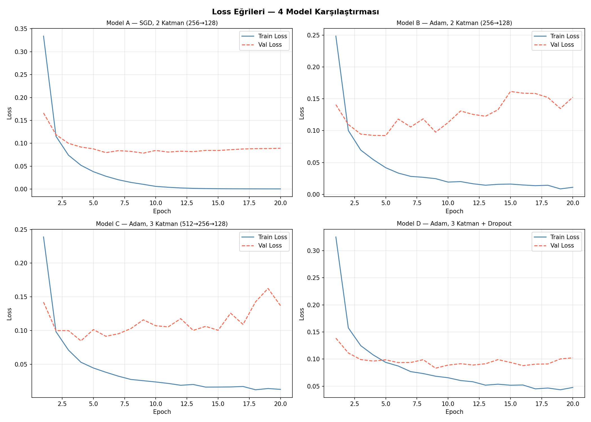
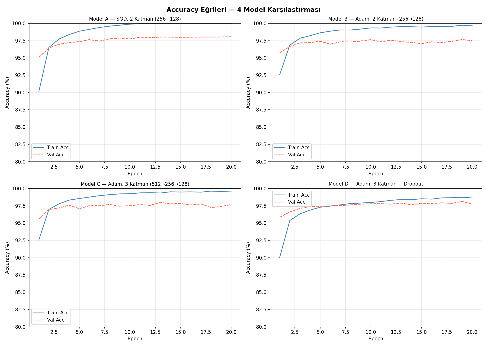
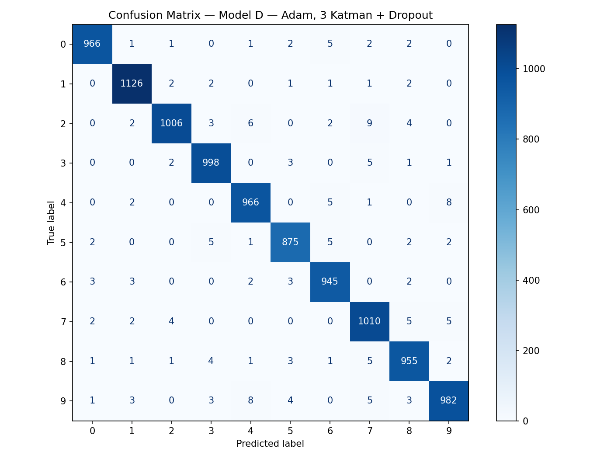
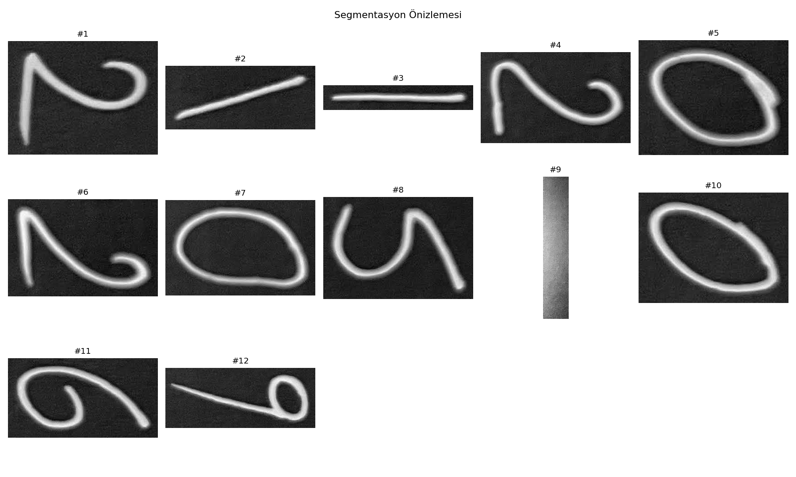
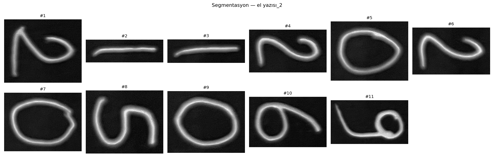

# MNIST Derin Öğrenme Projesi — Proje Raporu

**Remle Kanal**

---

## 1. Projeye Genel Bakış

### Proje Kapsamı

- 4 farklı MLP modeli tasarımı ve eğitimi (SGD/Adam, 2–3 katman, Dropout)
- Eğitim / doğrulama / test süreçlerinin 20 epoch boyunca takibi
- Loss ve accuracy eğrilerinin görselleştirilmesi
- Confusion matrix analizi (en iyi model için)
- Kendi el yazısı görüntülerine MNIST uyumlu ön işleme pipeline'ı
- Gerçek fotoğraflarda segmentasyon ve model testi

---

## 2. Veri Seti ve Ön İşleme

### 2.1 MNIST Veri Seti

| Küme | Görüntü Sayısı | Kullanım |
|---|---|---|
| Eğitim | 50.000 | Model ağırlıklarını öğrenmek |
| Doğrulama | 10.000 | Epoch başına performans izleme |
| Test | 10.000 | Nihai değerlendirme |

Orijinal 60.000'lik eğitim kümesi 50.000 eğitim + 10.000 doğrulama olarak ayrılmıştır (seed=42).

### 2.2 Normalizasyon

Tüm piksel değerleri MNIST veri setinin istatistiklerine göre normalize edilmiştir:

```
x_norm = (x / 255 − 0.1307) / 0.3081     [μ = 0.1307, σ = 0.3081]
```

### 2.3 El Yazısı İçin Ön İşleme Pipeline'ı

| Adım | İşlem |
|---|---|
| 1 | Gri tona çevirme |
| 2 | Arka plan tespiti — beyaz zemin ise piksel değerlerini tersine çevirme |
| 3 | Gaussian blur (σ=1) + eşikleme ile gürültü temizleme |
| 4 | Rakamın sıkı bounding-box'ı ile kırpma |
| 5 | En-boy oranı korunarak 20×20 iç kutuya sığdırma |
| 6 | Ağırlık merkezine göre 28×28 çerçevede ortalama (scipy.ndimage) |
| 7 | MNIST normalizasyonu (μ=0.1307, σ=0.3081) |

---

## 3. Model Mimarileri

Tüm modeller aynı MLP sınıfından türetilmiştir. Giriş: 784 (28×28 flatten), Çıkış: 10 sınıf.

| Model | Mimari | Aktivasyon |
|---|---|---|
| A — SGD Küçük | 784 → 256 → 128 → 10 | ReLU |
| B — Adam Küçük | 784 → 256 → 128 → 10 | ReLU |
| C — Adam Derin | 784 → 512 → 256 → 128 → 10 | ReLU |
| D — Adam Dropout | 784 → 512 → 256 → 128 → 10 | ReLU + Dropout(p=0.3) |

---

## 4. Eğitim Süreci ve Hiperparametreler

| Hiperparametre | Değer |
|---|---|
| Epoch sayısı | 20 |
| Batch size | 64 |
| Kayıp fonksiyonu | CrossEntropyLoss |
| Model A optimizörü | SGD (lr=0.01, momentum=0.9) |
| Model B / C / D optimizörü | Adam (lr=0.001) |
| Dropout olasılığı (Model D) | 0.3 |

---

## 5. Loss ve Accuracy Eğrileri

### 5.1 Loss Eğrileri



*Şekil 1 — 4 model için eğitim ve doğrulama loss eğrileri (20 epoch)*

- **Model A (SGD):** Train loss sıfıra yaklaşmıştır. Val loss ~epoch 10'dan itibaren hafif dalgalanmaya başlamış — düzensizlik olmaksızın overfitting işareti.
- **Model B (Adam, Küçük):** Loss ilk 3–4 epoch'ta hızla düşmüş; val loss dalgalı seyretmiştir.
- **Model C (Adam, Derin):** Daha yavaş başlangıç. Val loss zaman zaman train loss'un üzerine çıkmıştır.
- **Model D (Adam + Dropout):** Train ve val loss eğrileri birbirine en yakın; Dropout'un overfitting'i engellediğinin açık göstergesidir.

### 5.2 Accuracy Eğrileri



*Şekil 2 — 4 model için eğitim ve doğrulama accuracy eğrileri (20 epoch)*

- Tüm modeller ilk 5 epoch'ta **%95+** doğruluğa ulaşmıştır.
- **Model A:** Train accuracy %100'e yaklaşmış, val accuracy %98'de kalmıştır — overfitting.
- **Model D:** Train accuracy ~%98.6 ile görece daha düşük seyretmiş, ancak val accuracy en kararlı seyri göstermiştir.

---

## 6. Model Karşılaştırma Tablosu

| Model | Mimari | Opt. | Dropout | Train Acc | Val Acc | Test Acc | Süre |
|---|---|---|---|---|---|---|---|
| A — SGD Küçük | 784→256→128→10 | SGD | Hayır | %100.00 | %98.06 | %98.20 | 67.7 sn |
| B — Adam Küçük | 784→256→128→10 | Adam | Hayır | %99.65 | %97.51 | %97.68 | 72.6 sn |
| C — Adam Derin | 784→512→256→128→10 | Adam | Hayır | %99.64 | %97.69 | %97.91 | 89.1 sn |
| **D — Adam Dropout** | 784→512→256→128→10 | Adam | Evet | %98.64 | %97.75 | **%98.29** | 94.0 sn |

**En iyi model: D — Adam Dropout → %98.29 test doğruluğu**

### Temel Bulgular

- Model A train'de %100'e ulaşmış (ezberleme), test'te Model D'nin gerisinde kalmıştır.
- Derin mimari (C → D) tek başına kazanım sağlamamıştır; asıl katkı Dropout'tan gelmiştir.
- Dropout, %1.36 daha düşük train accuracy karşılığında genelleme performansını iyileştirmiştir.
- SGD, doğru ayarlandığında Adam tabanlı modellerle rekabetçi sonuç vermiştir.

---

## 7. Confusion Matrix Analizi

En iyi model olan **D — Adam, 3 Katman + Dropout** için test kümesi üzerinde oluşturulmuştur.



*Şekil 3 — Model D Confusion Matrix (10.000 test örneği)*

| Rakam | Toplam | Doğru | Hata |
|---|---|---|---|
| 0 | 980 | 966 | 14 |
| 1 | 1135 | 1126 | 9 |
| 2 | 1032 | 1006 | 26 |
| 3 | 1010 | 998 | 12 |
| 4 | 982 | 966 | 16 |
| 5 | 892 | 875 | 17 |
| 6 | 958 | 945 | 13 |
| 7 | 1028 | 1010 | 18 |
| 8 | 974 | 955 | 19 |
| 9 | 1009 | 982 | 27 |

### En Sık Karışan Çiftler

- **2 → 7** (9 örnek): 2'nin üst kısmı 7'ye benzemektedir.
- **9 → 4** (8 örnek): Kapalı 9 yazımı 4 ile karışmaktadır.
- **5 → 3** (5 örnek): El yazısında 5 ve 3 benzer kontur paylaşmaktadır.

En az hata: **1** (9 hata) — En fazla hata: **9** (27 hata).

---

## 8. El Yazısı Görüntüleri ile Test

### 1. Görüntü



12 segment tespit edilmiş, bunlardan **#9 sol köşedeki gölge artefaktıdır** (gerçek rakam değil).

### 2. Görüntü



11 segment tespit edilmiş ve **segmentasyon kusursuzdur** — 21120205069'un tüm rakamları ayrı ayrı doğru yakalanmıştır.


## 9. Sonuç ve Değerlendirme

| Kriter | Sonuç |
|---|---|
| En iyi test doğruluğu | %98.29 — Model D (Adam + Dropout) |
| En hızlı eğitim | Model A — 67.7 saniye |
| En kararlı eğitim | Model D — train/val eğrileri en yakın |
| En yüksek overfitting | Model A (Train=%100, Test=%98.2) |

### Çıkarımlar

- **Dropout, genelleme performansını artırmaktadır.** Model D en yüksek test doğruluğuna ulaşmış ve en kararlı eğitim seyrini göstermiştir.
- **Derin mimari tek başına yeterli değildir.** Asıl kazanım düzenlileştirmeden (Dropout) gelmiştir.
- **SGD rekabetçidir.** Doğru ayarlandığında Adam tabanlı modellerle benzer sonuç vermiştir.
- **Dağılım kayması kritik bir sorundur.** MNIST'te %98+ doğruluk elde eden model telefon kamerası görüntülerinde düşük güven skorları üretmiştir.

---

*Tüm grafikler ve model ağırlıkları `results/` klasöründe mevcuttur.*
